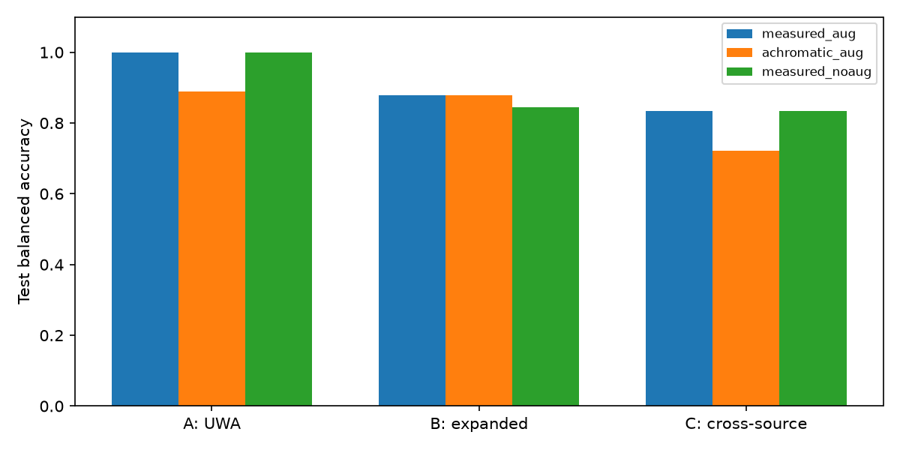

# D2: first bounded spatial-spectral simulation pilot

The chain runs, but **task benefit from wavelength-dependent encoding is not
established**. The expanded-negative protocol gives identical N1 classification
scores with measured and achromatic kernels. A source classifier perfectly
separates the small held-out UWA/CAVE negative set. This is a local research
prototype, not a calibrated camera simulator or general face detector.

## Data and license evidence

[CAVE official entry](https://cave.cs.columbia.edu/repository/Multispectral)
provides [the complete archive](https://cave.cs.columbia.edu/old/databases/multispectral/zip/complete_ms_data.zip)
for the research community. No broader redistribution/commercial permission was
established; data and derived scene images remain local. Cite the authors' dataset
and associated work as directed by the official page. UWA retains the stricter
local-research/no-redistribution treatment recorded in D0/D1; raw and derived
faces, individual manifests, predictions and checkpoints are not included here.

The complete archive is 405,988,465 bytes, SHA-256
`c22839ae5750e0f88451da40cc574b7c7de48f39fbfe0df44179f252afb91810`.
All ZIP CRC checks passed; 992 band PNGs from 32 scenes were decoded. Official
band numbering is 400–700 nm at 10 nm spacing, so images 06–26 supply the 21 nominal
centres. This is not a verified 10 nm spectral resolution or a measured bandpass.
31 scenes decode as 512×512 uint16 grayscale. **watercolors** instead contains
31 uint8 RGBA images and is rejected without conversion. No exact duplicate
full cubes were found.

Full-scene pseudo-RGB inspection accepted 26 non-face candidates. `face` and
`photo_and_face` contain faces; `egyptian_statue`, `chart_and_stuffed_toy` and
`stuffed_toys` are conservatively excluded for face-shaped/ambiguous content.
See [decisions](cave_review_decisions.json). These are Agent content annotations,
not official class labels or independent human adjudication. Charts, shared
backgrounds and repeated objects across CAVE scenes remain confounders; scene
isolation does not prove object/material independence.

The frozen D1 UWA subject split is unchanged. The pilot uses 58 acquisitions with
accepted paired face/non-face ROIs: 39/10/9 acquisitions in train/val/test.
The prior accepted unpaired faces remain preserved but unused. CAVE contributes
15/5/6 scenes, with [scene IDs and splits](cave_splits.json).

| Protocol | Original train/val/test ROIs | Derived train views |
|---|---:|---:|
| A: UWA Face / UWA Non-face | 78 / 20 / 18 | 78 |
| B: A + CAVE Non-face | 93 / 25 / 24 | 93 |
| C: UWA Face / CAVE Non-face | 54 / 15 / 15 | 54 |

The union has 142 original ROIs and 93 training views. No subject/scene group
crosses splits; deterministic augmentation replay passed. Derived views are not
independent measurements. The source manifest and frozen split hashes are
`6b78be9362302780d75319852f4c46a944e5acdaf8ca01a30150fec431888da0`
and `a32f71e88bee1379237ae11db68c90fae6e45cf47a5098c5108ac0930ee8aac3`.

## Physical and numerical scope

PSFs are from `spectral21_20261018_reset01`, 450:10:650 nm; historical acquisition
commit `18dd598852b1d44ea80b4f6d53e1d2d5656f9e9b`. Raw measurements were read only.
Matched pre/post dark means and the 1024 ROI border estimate are subtracted on
copies. Signed kernels are normalized per band; the central 512 support is block
summed by 16 to a 32×32 kernel. Equal weights, flat illumination, shift invariance,
zero boundaries and the scene-to-sensor pixel scale are explicit assumptions.
Bayer response and absolute spectral efficiency are not calibrated. Different
exposure DN sums are never treated as absolute throughput.

UWA processed intensity and CAVE approximate reflectance are rescaled into a
dimensionless equal-energy scene: bit-range division, resize, then grand mean
0.2. This suppresses a brightness cue, not the underlying domain difference.
All 21 bands share each affine/flip/amplitude transform; targets are recomputed.
Original data and historic D1 results are unchanged.

N1 uses four training-only spectral basis vectors and three PGD stages with a
shared small proximal network, **591 trainable parameters**, 32×32 spatial state.
It exposes `spectral_map [B,21,32,32]`, `global_spectrum [B,21]` and
`measurement_reprojection [B,32,32]`. Thirty fixed epochs and final checkpoints
were used, without test selection. Nine small model runs took 39.76 seconds on
four CPU threads. All losses and gradients remained finite.

Four no-hardware tests passed. Actual-kernel parity against unchanged D1 NumPy
operator: max absolute error 8.88e-16; adjoint relative error 4.33e-16.
Tests cover asymmetric/even kernels, autograd, augmentation replay and shared
band geometry, output means and reprojections. A separate batch-16 forward/backward
smoke used a peak 228,950,016-byte process working set (includes Python/Torch);
the original full-pilot memory counter failed, so this is not its measured peak.
See [runtime checks](runtime_checks.json) and [environment](environment.txt).

## Classification results

Fixed balanced L2 logistic heads, training-only standardization, identical source
splits. Oracle spectra are privileged inputs. The 650/550/450 proxy is not RGB.
Encoded observations are a single scalar plane, pooled to 8×8 for classification.
Test BA below uses measured kernels and augmentation:

| Protocol | Oracle 21 | Three-band proxy | Encoded plane | N1 spectrum | N1 Macro-F1 |
|---|---:|---:|---:|---:|---:|
| A | .9444 | .8889 | 1.0000 | 1.0000 | 1.0000 |
| B | .9000 | .8667 | .9333 | .8778 | .8693 |
| C | 1.0000 | 1.0000 | .9167 | .8333 | .8500 |

N1 test confusion matrices (rows truth, columns prediction; non-face then face):
A `[[9,0],[0,9]]`, B `[[13,2],[1,8]]`, C `[[4,2],[0,9]]`.
For B, fixed UWA test BA is .9444 (one of nine faces missed), while held-out CAVE
negative recall is only 4/6. Single-class CAVE BA/Macro-F1 are undefined.
Individual failure records are retained locally for review.

| N1 control | A test BA | B test BA | C test BA |
|---|---:|---:|---:|
| measured + augmentation | 1.0000 | .8778 | .8333 |
| achromatic + augmentation | .8889 | .8778 | .7222 |
| measured, no augmentation | 1.0000 | .8444 | .8333 |

Encoded-plane classification is unchanged by the achromatic control in the
augmented protocols (A 1.0, B .9333, C .9167). Thus spatial/source cues are sufficient
for these small tests. A's N1 difference is two examples; a single seed and nine
held-out acquisitions do not establish a robust spectral advantage. C explicitly
confounds source and task label.

The source diagnostic uses **negative samples only**, with simple brightness,
contrast, quantiles and spatial statistics after common normalization. Held-out
BA and Macro-F1 are 1.0 on nine UWA and six CAVE negatives, confusion `[[9,0],[0,6]]`.
This directly shows residual source cues; it does not identify their unique cause.

## Fidelity, failures and sensitivity

| Measured+aug test metric | A | B | C |
|---|---:|---:|---:|
| Mean relative global-spectrum L2 | .0656 | .1187 | .1249 |
| Global map relative L2 | .1395 | .3777 | .4204 |
| Measurement relative L2 | .0160 | .0386 | .0506 |
| Negative map fraction | 0 | .0185 | .0265 |

N1 is not constrained positive. Negative values are exposed, not silently clipped.
For B, the fixed 1024-support perturbation changes the observation by 2.91% and
global error to .1241; the scale perturbation changes it by 16.26% and error to
.1377. Nonnegative kernels and a .8–1.2 spectral weight ramp have smaller effects
in this pilot. All perturbations and train/val/test metrics are in
[aggregate results](results.json); no perturbation was used for model selection.

Zero measurement still produces nonzero spectrum norms (.148/.139/.091 for A/B/C).
The learned prior therefore contributes output unsupported by incoming energy.
Measurement consistency is useful but does not eliminate null-space ambiguity.
This, source cues, cross-band registration limitations, small independent sample
counts and approximate radiometry prevent a claim of recovered physical spectra
or useful general face discrimination beyond RGB.

## Decision and reproducibility

The first evidence chain is operational. Do not expand model capacity based on
these scores. First review task-matched negatives and the source diagnostic,
then decide whether the global spectrum is the right task feature and whether
physical scale/radiometry require tighter controls. Local/spatial classifier
heads were not added: direct encoded features already perform well and the
present failures do not justify C2/C3.

Source and commands are in [experiments/d2](../../../experiments/d2/README.md).
Local outputs include the full original archive, band hashes, reviewed cubes,
frozen manifest, augmentation seeds, kernels and provenance, all nine checkpoints,
map/curve/reprojection examples and individual failures. Restricted data are
excluded from this report. No acquisition host, production code or existing
Meta acquisition pin was changed; no hardware validation was run.
