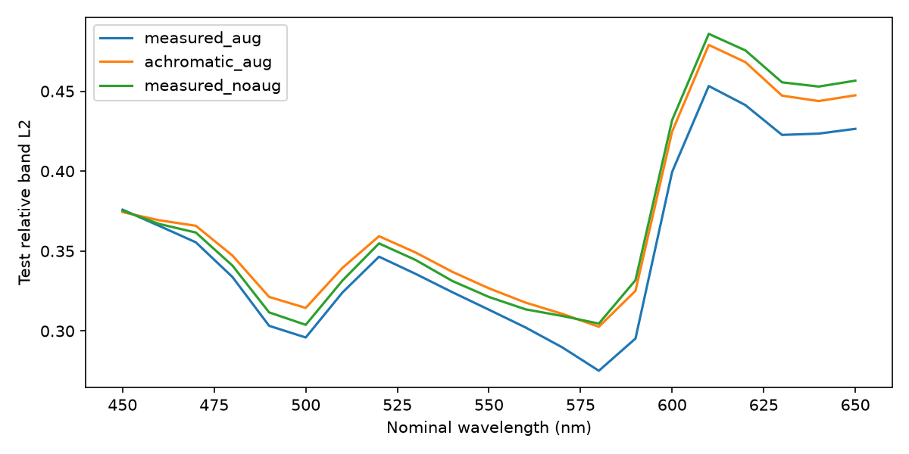
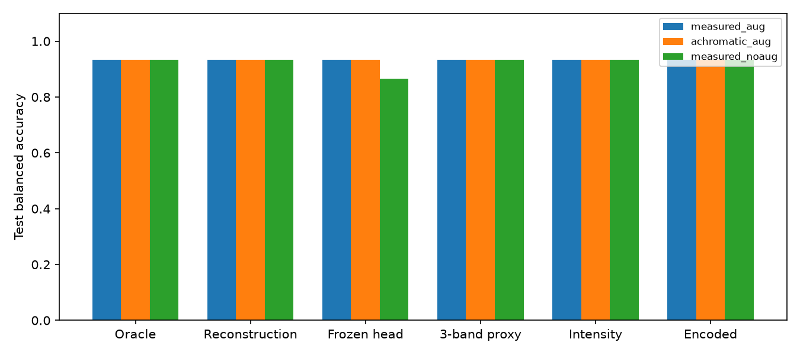

# D3: full 21-channel reconstruction and independent classification

**Executed:** a complete 21-channel spatial-state N1, three independently trained
controls, frozen N1 classification, and numerical/data validation. **Not established:**
general scene recovery, cross-domain face generalization, or an LCD spectral
classification benefit. The task score is matched by intensity-only and
achromatic controls; high-frequency and CAVE spectral errors remain substantial.
D2 results were not overwritten.

## Before and after

D2 already supplied immutable data/splits, guarded shared-band augmentation,
measured FFT convolution/adjoint, and a tested low-rank pilot. D3 reuses them.
New work adds an explicit singleton measurement channel, a full 21-channel PGD
state without a spectral basis, reconstruction-only supervision, reusable fitted
classification heads and an actual frozen-head transfer experiment.

No physical acquisition, production-code change or Meta pin update occurred.
This is a bounded 32x32 approximation, not a newly calibrated sensor or a claim
that all natural scenes can be reconstructed from a single encoded image.

## Data audit and usage boundary

Reuse the [D2 CAVE acquisition/license evidence](../2026-10-20-d2/README.md)
and D0/D1 UWA audit. UWA archive restrictions are treated as local research with
no redistribution of raw or derived faces. CAVE is provided to the research
community; broader redistribution/commercial permission was not established.
Only code, aggregate metrics and aggregate figures belong in this repository.
No faces, individual UWA manifests, predictions, model weights or raw cubes.

Actual CAVE `face` and `photo_and_face` images were reviewed. New crops:

| Scene | Presentation | Original `(x,y,width,height)` |
|---|---|---|
| face | physical person | (112,64,400,400) |
| photo_and_face | physical person | (272,176,240,272) |
| photo_and_face | printed photo | (16,224,176,224) |

The task means **a recognizable human face in a candidate region**, including
photographs. It is not liveness, skin recognition or identity recognition.
All three are Agent-reviewed task annotations, not official CAVE labels or
independent human adjudication. The two source scenes have unverified acquisition
independence and are conservatively one train-only group. Three crops do not
create three independent scenes. No identity matching was performed.

The crops decode as uint16, finite, with maxima 56,700 / 30,784 / 27,206 and no
65535 values. This does not prove optical non-saturation. Values of 255 are
ordinary quantized values, not an optical saturation rule. Native aspect ratios
are resized to 32x32 for the pilot and this is recorded. Source-band phase
correlation is retained locally as an uncertain diagnostic, not a registration
correction. UWA's existing motion, processed DN and quantization limits persist.
The D2 watercolors format exception and ambiguous toy/statue exclusions remain.

| Split | UWA Face | UWA Non-face | CAVE Face | CAVE Non-face | Original ROIs | Train views |
|---|---:|---:|---:|---:|---:|---:|
| train | 39 | 39 | 3 | 15 | 96 | 96 |
| validation | 10 | 10 | 0 | 5 | 25 | 0 |
| test | 9 | 9 | 0 | 6 | 24 | 0 |

145 original ROIs represent 58 UWA acquisitions from 41 subjects and 28 CAVE
scenes. UWA subjects are 28/7/6 across train/val/test. The CAVE face pair is grouped
together; scene isolation is not evidence that every object/material is distinct.
There is **no independent CAVE positive validation/test set**. Class balance by
source is still inadequate for a general cross-domain classification claim.

All original D1 sample hashes, frozen splits, D2 numerical scenes and 21 PSF source
hashes were verified. All 241 original/derived cubes have shape [21,32,32], finite
values and correct 450:10:650 ordering. Recomputed global supervision is identical.
96 deterministic training views replay; two unsafe affine draws were rejected
without weakening the whole-ROI guard. No validation/test views are augmented.
The first incomplete preparation and the rejected-transform attempt are preserved;
the successful dataset is the separate `prepared03` output.

No new registration algorithm or arbitrary spectral correction was introduced.
The processed inputs retain bit scaling followed by dimensionless grand mean 0.2.
That equal-energy assumption does not equate UWA intensity and CAVE reflectance.
The source diagnostic (negative content only) has test BA=1.0 and Macro-F1=1.0
on 9 UWA + 6 CAVE negatives, **before equal-energy scaling, after scaling, and with
training augmentation**. These operations did not remove source separability.

## Forward and reconstruction experiment

Measured PSFs are from `spectral21_20261018_reset01`, hardware acquisition commit
`18dd598852b1d44ea80b4f6d53e1d2d5656f9e9b`. D2 dark/border correction, signed
unit-sum shape kernels, coordinate origin and 512 support are retained; block
sum factor is 16. A 1024-support mismatch is evaluated without altering raw PSFs.

`X [B,21,32,32] -> y [B,1,32,32]`. This scalar sum is not RAW8 Bayer imaging.
Weights are 21 ones, illumination is flat, and absolute efficiency is unknown.
Boundary is zero; the full candidate scene is convolved before downstream pooling.
Shift invariance and scene/sensor scale remain assumptions. No overlapping patches
are counted as independent measurements.

N1 has 3 PGD stages, a shared 21->32->21 convolutional proximal, **12,152 parameters**,
and a final bounded consistency step. There is no basis, low-rank factorization or
spectral bottleneck. It exports full maps, global spectra, reprojections and residuals.
Loss: map MSE + .2 spatial-gradient MSE + .05 spectral-cosine error + .02 normalized
measurement MSE. Spectral shape uses target pixel norm >1e-3 in dimensionless units.
N1 receives no class labels or classification gradient. Main simulation is noiseless.

Three fixed-seed, 60-epoch final-checkpoint runs use measured+augmentation,
achromatic+augmentation, and measured without augmentation. No test tuning or
best-test checkpoint selection. All gradients and losses were finite. Total
training/classification run took 140.38 seconds, four CPU threads, peak process
working set 960,585,728 bytes. Measured-model inference was about 4.25 ms/scene
in a separate 50-repeat CPU check; this is local timing, not a hardware guarantee.

The test suite covers D1 parity, asymmetric even kernels, adjoints, autograd and
directional derivatives, full-state outputs, augmentation replay and classifier
freeze/train-only fitting. Actual measured-kernel directional relative error was
9.48e-10. Seven tests passed. Aggregate numerical checks are linked below.

## Independent reconstruction acceptance

Metrics use all untouched original test ROIs; relative map error is the aggregate
Frobenius norm ratio, spectral angle is mean pixel angle, residual is relative
measurement norm. Domain results must be read separately.

| Control | Map relative L2 | Spectral angle (deg) | Spatial gradient relative L2 | Measurement relative L2 |
|---|---:|---:|---:|---:|
| measured + augmentation | .3696 | 10.274 | .7600 | .0448 |
| achromatic + augmentation | .3886 | 9.556 | .7807 | .0569 |
| measured, no augmentation | .3905 | 9.834 | .7844 | .0590 |

Measured+aug map errors are .2954 train, .3249 validation, .3696 test.
For UWA test: map .1522, angle 5.805°, residual .0264.
For CAVE test: map .4896, angle 23.679°, residual .0649.
Aggregate improvement in map error does not imply improvement in every metric:
achromatic spectral angle is slightly smaller. One seed is not a significance test.

Errors are particularly large at 600–650 nm in these scenes. High-frequency
relative error (radial frequency >=.25 cycles/simulation-pixel) is .7924 overall
and 1.1790 on UWA, versus low-frequency errors .3421 and .1360 respectively.
This reflects weak high-frequency recovery, not a validated optical cutoff.
Signed outputs contain .47% negative values overall; none were silently clipped.

| Fixed mismatch probe, measured model | Map relative L2 | Angle (deg) | Residual relative L2 |
|---|---:|---:|---:|
| Gaussian 1% training observation RMS | .3698 | 10.280 | .0454 |
| Gaussian 5% training observation RMS | .3733 | 10.544 | .0572 |
| 1024 PSF support | .3735 | 10.145 | .0445 |
| hypothetical RGGB response | .3833 | 10.951 | .2804 |

RGGB uses assumed Gaussian spectral responses, not this camera's measured CFA;
it is an out-of-model sensitivity only. Weights .8–1.2 and nonnegative-kernel
probes are in the complete metrics. No probe was used for model selection.
Zero input still produces a mean global-spectrum norm .0485: the prior can
produce spectral content unsupported by measured energy.

One plane has 1,024 measurements and the full state has 21,504 unknowns.
Recovery is underdetermined. A nonnegative illustrative cube pair differs by
2.315% in norm while its simulated observations differ by 1.58e-7 relatively.
The CG projection reached its 500-iteration limit; this is a measured near-null
example, not a certified exact null-space solve or a realistic scene prior.
Small reprojection error cannot establish unique spectral recovery.

## Independent C1 acceptance

C1 is a low-capacity logistic head on a 4x4 pooled spatial-spectral cube, with
336 input features plus intercept, balanced loss and fixed L2=.01.
Training-only standardization; no test labels or fitting. N1 weights are frozen
and verified byte-hash unchanged throughout classification.

- Oracle: fit and evaluate C1 using true cubes.
- Reconstruction: fit a separate C1 using frozen N1 outputs.
- Frozen-head: use Oracle C1's unchanged weights and normalization on N1 outputs.

| Measured+aug protocol | Train BA | Validation BA | Test BA | Test Macro-F1 |
|---|---:|---:|---:|---:|
| Oracle | 1.0000 | .9333 | .9333 | .9143 |
| Reconstruction | 1.0000 | .9333 | .9333 | .9143 |
| Frozen-head transfer | .9722 | .8833 | .9333 | .9143 |

Test confusion for these three is `[[13,2],[0,9]]`, rows truth and columns
prediction, non-face then face. UWA test BA is 1.0 on only nine paired acquisitions
from six subjects. CAVE test negative recall is 4/6; BA/F1 for CAVE alone are
undefined because there are no positive test samples.

Achromatic N1 gives the same .9333 test BA for all three protocols. Without
augmentation, reconstruction C1 remains .9333 but frozen-head transfer falls to
.8667 (Macro-F1 .8322). Training on UWA only gives Oracle test BA .9000 in the
augmented condition, compared with .9333 for mixed-source training; this is a tiny,
confounded diagnostic, not causal evidence that CAVE faces solved the bias.

The Oracle three-band 650/550/450 **proxy**, pure spatial-intensity head, and encoded
plane head all match .9333 BA. Global-spectrum heads score .9000 Oracle and .8667
measured N1. Thus there is no measured task advantage from the 21-band spectral
representation in this test. These proxy bands are not calibrated RGB.

`superballs` and `flowers` are the two CAVE false positives, also missed by Oracle;
the errors are not attributable solely to reconstruction. Local per-sample
predictions and matched target/reconstruction visualizations remain available.
No network expansion was triggered to fit these test failures.

## Decision, artifacts and remaining limits

The independent modules and their interfaces are operational; universal recovery
and spectral task gain have **not** passed scientific acceptance. Do not proceed
to compression or joint end-to-end optimization on the strength of these scores.
First decide how to obtain genuinely independent, source-balanced positive and
negative scenes and how to tighten the physical observation assumptions.
No new experiment or dataset acquisition is automatically started by this report.

[Reproduction commands and configuration](../../../experiments/d3/README.md),
[complete aggregate metrics](results.json),
[data validation](data_validation.json),
[numerical diagnostics](numerical_diagnostics.json) and
[final data checks](final_data_checks.json) accompany this report.

Local outputs retain manifest/splits, crops, seeds, source hashes, full N1 arrays,
frozen heads, checkpoints, per-case errors and private previews. All 21 bands of both 512/1024 kernels were reproduced exactly from source ROI
and matched dark arrays ([hashes and checks](psf_reproduction.json)). Actual input
hashes and working environment are recorded; raw/derived faces are not published.
D1/D2 outputs remain immutable. No new hardware/SDK checks were performed.
