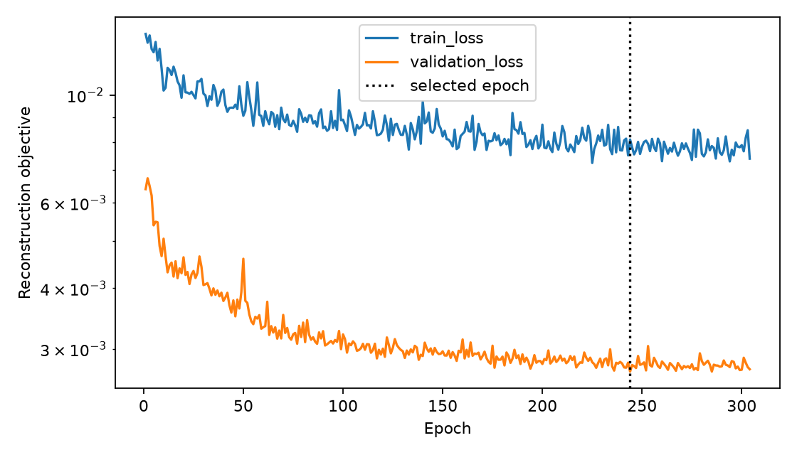

# D4 — independent general reconstruction

Execution: 2026-10-20–21. **GPU training and independent evaluation completed; high-quality general reconstruction NOT accepted.** Local spectral and high-frequency errors remain substantial. C training, compression and joint optimization remain deferred. D2/D3 evidence is unchanged.

## Architecture and data independence

The intended system is shared UDC RAW → independent R and N1 → aligned outputs consumed by independent C. N1 predicts `[B,21,H,W]`, with reprojection and global spectrum as auxiliary outputs. Training consumes no face boxes, class labels, class balancing, classifier gradients or downstream scores. Reconstruction quality is a necessary foundation.

D3 separated losses but used classification-selected ROIs, equal-energy normalization and32² resolution. D4 uses whole CAVE scenes at128², divided by65535 without scene-wise energy normalization: **17 train / 5 validation / 6 development test / 3 final reserve**. Face scenes are not excluded. `watercolors` is excluded only for unresolved8-bit RGBA format. `face`/`photo_and_face` share a conservative train group. The validation set contains related food scenes and is not representative of all scenes.

Final reserve: `egyptian_statue`, `chart_and_stuffed_toy`, `stuffed_toys`. Previously content-inspected, these are not never-viewed blind scenes; their arrays are absent from prepared tensors and were not evaluated here. Selected training used304×17=5168 ephemeral augmented views, still17 independent source scenes. All21 bands share flips/quarter-turns and global0.9–1.1 brightness scaling before forward simulation. Validation/test are deterministic.

## Physics, model and provenance

Read-only measured source: `spectral21_20261018_reset01`; actual acquisition commit `18dd598852b1d44ea80b4f6d53e1d2d5656f9e9b`. Original1024 ROI `(866,554,1024,1024)`, matched pre/post dark and outer-border background correction, signed central512 normalization,8×8 integration to64² kernels. Unit wavelength weights, zero boundaries, spatial invariance, single-channel observation and8:1 sensor/simulation scale remain assumptions. No calibrated Bayer response, absolute spectral throughput or scene magnification is claimed. Whole truth scenes are simulated, not overlapping observation patches.

- Prepared manifest SHA256: `de334816a9b7a4dd381f193336a9db891b47db404a6b3c5c503c052c77d544bb`.
- Physics record SHA256: `a39f2423e06a01e96dffe495b3d026a71428b35252fa6225c87812b3c8781d22`.
- Selected checkpoint SHA256: `d7c331ae3319e14aac49509f5f978c04448337341ee76187410b14d5f3d1442a`.

FFT forward/adjoint and even-kernel crop/origin definitions are reused. Additional1024-support sensitivity uses the same correction/scale; integration agrees with prior coarser operators to1.50e-8 maximum absolute error. Signed tails/truncation remain physical limitations.

Full21-state PGD has shared convolutional priors, no imposed low-rank bottleneck. Loss: cube MSE +0.2 spatial-gradient MSE +0.05 pixel spectral-cosine loss +0.02 measurement MSE normalized by training measurement RMS². Spectral loss/SAM uses truth norm>1e-3. AdamW lr3e-4, cosine decay, batch2, maximum400epochs, patience60, Gaussian training noise0.5% training measurement RMS. TF32 off; cuDNN deterministic; finite gradients checked every batch.

## GPU execution and selection

Separate Python3.13.5 / PyTorch2.7.1+cu128 environment; RTX3060Ti8GB. Official wheel verified against SHA256 `500ad5b670483f62d4052e41948a3fb19e8c8de65b99f8d418d879cbb15a82d6`. Historical CPU environment preserved. Earlier approval-credit/download blockers are resolved.

| Run | Stages / width / depth | Parameters | Epochs / selected | Minimum validation objective | Total run time |
|---|---|---:|---:|---:|---:|
| gpu01 | 6 / 64 / 4 | 98,139 | 398 / 338 | .00295561 | 173.43s |
| gpu_capacity01 | 8 / 96 / 5 | 285,533 | 304 / 244 | **.00269432** | 251.12s |

The single capacity comparison was fixed in `a7c1a48` during the first run, before development-test inspection. Selection used validation objective only and was recorded before reading test outcomes. Both runs stopped after60epochs without improvement. Training augmentation/noise and different scene composition explain part of the train/validation gap; it is not proof against overfitting. Selected model:1.02GiB peak CUDA allocated memory,12.53ms median single-scene inference; these are not total VRAM or end-to-end throughput.

## Independent reconstruction results

[Machine-readable aggregate metrics](aggregate_metrics.json). Values are scene means, not pooled pixels. Fixed unit-range PSNR, no clipping; band-mean SSIM. Relative L2 means error norm/truth norm. Clean matched-model observations unless specified.

| Evaluation | PSNR dB | SSIM | SAM degrees | Cube relative L2 | Global spectrum relative L2 | Measurement relative L2 |
|---|---:|---:|---:|---:|---:|---:|
| N1 train17 | 24.98 | .793 | 15.96 | .355 | .144 | .0315 |
| N1 validation5 | 29.33 | .889 | 9.60 | .326 | .138 | .0352 |
| **N1 development test6** | **24.67** | **.703** | **19.21** | **.419** | **.180** | **.0341** |
| Landweber100, same6 | 23.74 | .701 | 27.91 | .468 | .295 | .0086 |
| N1 UWA16 whole acquisitions | 25.39 | .896 | 16.81 | .281 | .253 | .0129 |

N1 improves spectral error but high-frequency relative error is.894 versus Landweber.830, spatial-gradient error.751 versus.720, and measurement residual is worse. Better SAM alone is insufficient. Low residual cannot prove unique inversion of this underdetermined21-to1 model. Negative output fraction averages.000131; outputs were not clipped.

Private panel review found:

- `beads`:18.26dB, SSIM.459, cube error.598, SAM25.37°; fine structure lost.
- `superballs`: cube error.568 despite SSIM.794; spatial appearance hides spectral/amplitude error.
- `feathers`: global spectrum error only.0656, yet local spectra lose sharp peaks and long-wavelength changes; cube error.327, SAM21.36°. Global averages do not certify spectral maps.
- `cloth`: high-frequency error.965; texture recovery weak.
- Best scene `real_and_fake_apples` still has cube error.274, SAM14.20°.

Mean per-band relative errors span.304–.547, worst near470nm and best near590nm. These reflect scene signal and assumed physics, not sensor efficiency. Six development scenes and one seed do not establish broad generalization.

## Noise, model mismatch and new sources

| Changed input, frozen N1 | Cube relative L2 | SAM degrees | Assumed-model residual | Changed-model residual |
|---|---:|---:|---:|---:|
| Gaussian1% training RMS | .419 | 19.33 | .0373 | — |
| Gaussian5% training RMS | .423 | 21.49 | .0798 | — |
| Achromatic average PSF | .418 | 19.21 | .0339 | .0336 |
| Efficiency ramp0.8→1.2 | .417 | 19.13 | .0340 | .0362 |
| Negative tails clipped | .419 | 19.21 | .0340 | .0349 |
| Signed1024 support | .421 | 19.12 | .0335 | .0461 |

These are input-mismatch tests, **not retrained achromatic comparisons**. Near-identical achromatic results do not establish exploitation of wavelength-specific coding. Modest tail/support effects here do not validate other scales. Zero input produces RMS.00212 through the learned prior, material for dim signals.

UWA uses all16 frozen D1 test subjects' first-session full frames, no face/label filter and no model fitting on UWA. DN/255 is processed intensity, not CAVE reflectance. Sequential motion and255-value ambiguity remain; some acquisitions were evaluated historically in D3. This is a domain diagnostic, not a new blind benchmark or classification result.

One [Harvard official](https://vision.seas.harvard.edu/hyperspec/download.html) mixed-light sample `img3.mat` was extracted completely from a retained128MiB archive prefix. **Full archive and gzip trailer remain unverified.** SciPy compressed-member validation passed:1040×1392×31float64, all finite, range0–.05335. Fixed central512² truth crop `(440,264,512,512)` is fully valid under `lbl`, then resized and simulated. Nominal420–720nm channels3:24 provide450–650nm. SHA256 `d1d59fb149bbf127a354ef8893d801eeb06f21266c7d8af8b34b213609a863b6`.

Archive README grants research/academic use; website specifies non-commercial research. Originals/derivatives stay local. The [source paper](https://vision.seas.harvard.edu/hyperspec/CZ_hss.pdf) describes camera-weighted bands without sensitivity normalization; no CAVE equivalence was imposed.

Native intensity: PSNR50.50dB yet SAM34.06°, cube error.665, residual.233. Fixed unit-range PSNR flatters this dim sample. Predeclared synthetic gain10: SAM32.55°, cube error.552, residual.0321. Both cases are reported, not selected by score. Neither establishes good new-domain recovery; one sample cannot characterize a domain.

## R, tests and reproducibility

Minimal R explicitly demosaics Bayer with OpenCV, retaining observation identity/coordinates and black/white levels; scalar input rejected. Official MIT YuNet2026may actually ran on Oracle650/550/450 proxy → synthetic Bayer → RGB:1 proposal in `face`,2 in `photo_and_face`,0 in `balloons`, threshold.9. Model SHA256 `ebafce4e3c118d6554634be5c27ab333b4c047a9a8c3faf1d7cf93101c22f0f0`; [model/license](https://github.com/opencv/opencv_zoo/tree/main/models/face_detection_yunet). This is an interface check, not detector accuracy or recovery from diffracted UDC RAW. Same-RAW RGB/spectral fusion remains unverified.

Final CUDA-environment command from reconstruction: `python -X utf8 -m pytest -q -p no:cacheprovider`: **15 passed in6.87s, no skips**. Includes CPU/GPU forward/adjoint parity, float64 directional derivatives, finite training gradients, replayable all-band augmentation, full-state output, split guards, fixed-range metrics and Bayer semantics. Earlier2epoch CPU smoke is execution evidence only, not quality acceptance.

[Reproduction instructions](../../../experiments/d4/README.md). Local evidence under `outputs/d4_general_20261020/`: `prepared01`, `gpu01`, `gpu_capacity01`, `selected_diagnostics01`, `selected_uwa01`, `selected_harvard01`, `rgb_smoke01`. Checkpoints, private panels, source samples, environment and execution hashes remain local. Public artifacts contain aggregate metrics and a loss curve only.

## Decision

The independent full-state GPU baseline is implemented and executed. **It is not yet a high-quality general reconstructor.** Do not proceed to C training, compression or joint optimization on this evidence. Next work should version a larger licensed general-scene dataset and radiometric assumptions, examine recoverability at the chosen PSF/pixel scale, and improve local spectral/high-frequency fidelity using training/validation evidence. Freeze a new protocol before further comparisons; do not tune against these development-test failures. Preserve the final reserve until acceptance.

No hardware connection, optic_system edit, Meta pin update or D4 push occurred.
